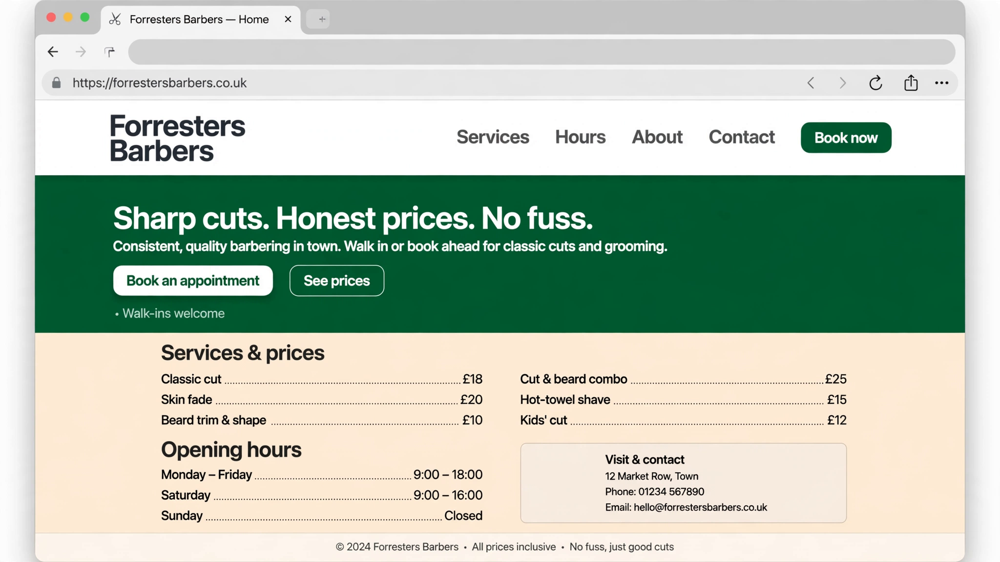
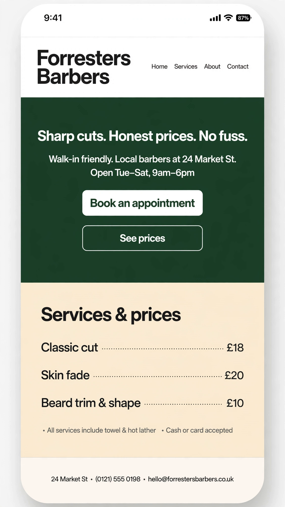

# MVP Website Starter

A clean, fast, mobile-friendly one-page website template for a small business — built as a reusable starter from real MVP demo sites made for local businesses (barbers, salons, plumbers, cafés) that had no website or only a weak one.

No build step. No backend. No database. Just three files — open `index.html` and it works.




> Note: the screenshots above are AI-generated mockups showing how the template is meant to look, not literal renders of `index.html` — a few small details in them (e.g. the address and closing time) differ from the example values in `script.js`. The code itself is the source of truth; open `index.html` to see the real page.

## Deploy it in one click

GitHub Pages: push these files to a repo → **Settings → Pages** → Source **Deploy from a branch**, branch `main`, folder `/ (root)` → live at `https://<your-username>.github.io/<repo-name>/` within a minute or two.

## What's inside

| File | What it does |
| --- | --- |
| `index.html` | The page structure: hero, services & prices, opening hours, about, contact, footer. |
| `styles.css` | All styling. Brand colour lives in `:root` at the top (`--accent`). |
| `script.js` | **The config lives here.** Edit `SITE_CONFIG` at the top and the whole site updates. |
| `screenshots/` | Example screenshots of the template as a barber shop site. |

## Customise it for a business (5 minutes)

**Edit one place only: the `SITE_CONFIG` object at the top of `script.js`.** You do not need to edit `index.html`.

```js
const SITE_CONFIG = {
  businessName: "Forresters Barbers",
  tagline: "Sharp cuts. Honest prices. No fuss.",
  // …services, hours, address, phone, email, bookingUrl
};
```

1. **Name, tagline, about text** — replace the example words with the business's own.
2. **Services & prices** — one line per service: `{ name: "Classic cut", price: "£18" }`. Add or delete lines to add or remove a service.
3. **Opening hours** — one line per row: `{ days: "Monday – Friday", time: "9:00 – 17:30" }`. Use `"Closed"` for shut days.
4. **Contact details** — `address`, `phoneDisplay` (what visitors see), `phoneHref` (must start `tel:` with no spaces, e.g. `tel:+441271123456`), `email` / `emailHref` (`mailto:…`).
5. **Booking link** — `bookingUrl` should point at the business's booking page (Booksy, Fresha, Calendly, or similar). If there is no booking page yet, put the phone link there (`tel:+44…`) or `"#contact"` so the button scrolls to the contact section.
6. **Colour** — change `--accent` in `:root` at the top of `styles.css` to match the business's branding.
7. **Photos** — this starter ships without photos on purpose (so it works anywhere with no assets to break). Add real photos of the actual business in an `images/` folder and reference them from `index.html` if you have them. Do not use stock photos of someone else's shop and present them as the business.

The example content is a fictional barber shop ("Forresters Barbers", Barnstaple) used to show the template. The phone number, email and address in the example are placeholders — replace them all before publishing for a real business.

## Preview it

- **Easiest:** double-click `index.html` (or right-click → Open With → your browser). Everything works from the local file.
- **Or serve it locally:** `python3 -m http.server` in this folder, then open http://localhost:8000.

## Deploy it free

Any static host works. Two free options:

### GitHub Pages (free)
1. Create a new repository on GitHub and upload these files (or `git push` them).
2. Go to **Settings → Pages**.
3. Under "Build and deployment", set Source to **Deploy from a branch**, branch `main`, folder `/ (root)`.
4. Save. Your site is live at `https://<your-username>.github.io/<repo-name>/` within a minute or two.

### Netlify (free tier)
1. Drag this folder onto [app.netlify.com/drop](https://app.netlify.com/drop), or connect the GitHub repo.
2. No build command, no publish directory to set — the site root is the publish directory.

To use a custom domain (e.g. `www.yourshop.co.uk`), buy the domain from any registrar and follow that host's "custom domain" instructions — both hosts above support it on their free tiers.

## What is intentionally left out

- **No booking backend.** The "Book now" button is a link — to a booking page, or to the phone number. There is no calendar, no availability check, and no form that stores bookings.
- **No contact form backend.** Email and phone are plain links. If a form is needed later, add a free form service (e.g. Formspree) rather than building a server.
- **No CMS.** Changes mean editing `SITE_CONFIG` in `script.js` and re-deploying. That is a deliberate trade-off for a site this small: nothing to update, nothing to hack, nothing to pay for monthly.
- **No analytics, no cookies, no tracking.** Add your own analytics snippet if the business wants it.
- **No photos included.** See "Photos" above.

## Honest notes

- This is a starter template, not a finished website for any specific business. Every demo built from it is a starting point the business owner should review and approve before it goes live.
- No clients, users, or results are claimed for this template. The example business is fictional and used only to demonstrate the layout.
- Built by [ViraBuilds](https://github.com/ViraBuilds) — an AI-assisted builder making small MVP websites for small businesses. Questions or fixes: open an issue on GitHub.

## License

MIT — see [LICENSE](LICENSE). Use it for any business, commercial or personal, with attribution.
